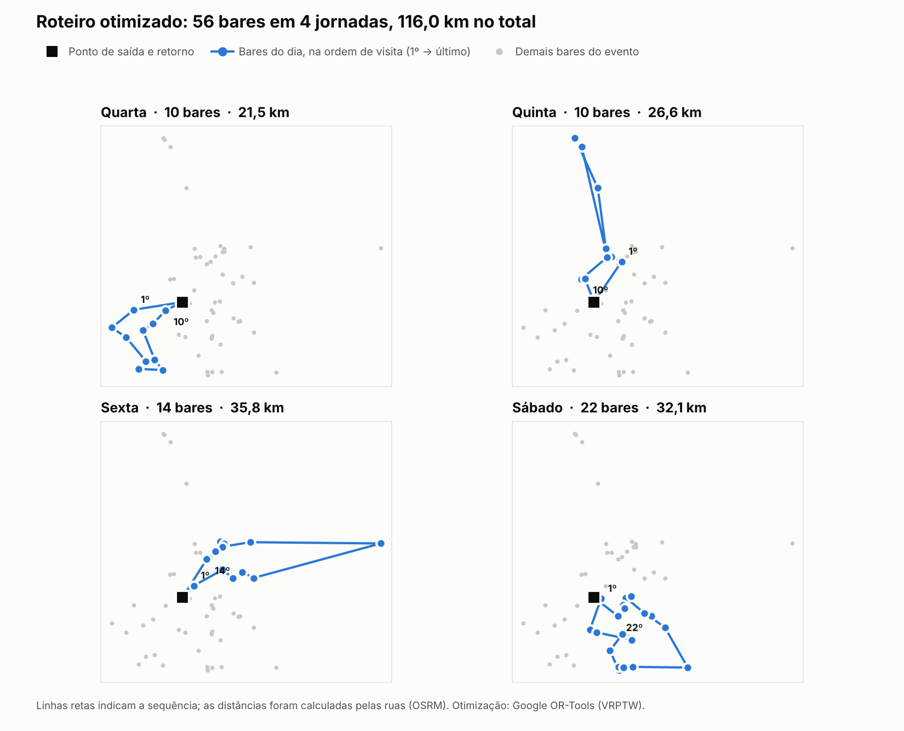

# 🍺 Rota ótima pelos 56 bares do Comida di Buteco Campinas

**Qual a melhor ordem para visitar os 56 bares do Comida di Buteco em Campinas?** Só no sábado, com 22 bares, são cerca de 10²¹ ordens possíveis, e cada bar abre e fecha em um horário diferente.

Tratei a pergunta como um **Problema de Roteirização de Veículos com Janelas de Tempo (VRPTW)** e construí um pipeline de ponta a ponta: coleta automática dos dados, distâncias reais pelas ruas e otimização com Google OR-Tools.

> 📄 Artigo apresentado no **X SAEPRO – Simpósio Acadêmico de Engenharia de Produção (EEL-USP)**, 2026.
> Autores: Breno Graniero, Murilo Demarchi Silva e Renan Carbonera · Orientação: Prof. Dr. Marcos Ricardo Rosa Georges (PUC-Campinas)

[](https://colab.research.google.com/github/renancarbonera04/portfolio/blob/main/01-roteirizacao-comida-di-buteco/roteirizacao_bares.ipynb)

## Resultado

**56 bares em 4 jornadas e 116 km na semana, contra 227 km visitando na ordem alfabética: quase 49% a menos.**



| Dia | Bares | Distância | Primeira chegada | Retorno |
|---|---:|---:|---:|---:|
| Quarta | 10 | 21,5 km | 11:30 | 22:05 |
| Quinta | 10 | 26,6 km | 11:00 | 22:48 |
| Sexta | 14 | 35,8 km | 11:30 | 19:47 |
| Sábado | 22 | 32,1 km | 07:00 | 23:06 |
| **Total** | **56** | **116,0 km** | | |

*As distâncias por dia foram recalculadas a partir de [`data/roteiro_semanal.csv`](data/roteiro_semanal.csv) e da matriz de distâncias.*

**O que mais ensinou:** o ótimo do modelo nem sempre é o ótimo da vida real. Para encurtar o caminho, o solver montou um sábado de 16 horas (07:00 às 23:06). O próximo passo natural é limitar a duração de cada jornada.

## Como funciona

| Etapa | O que faz | Ferramentas |
|---|---|---|
| 1. Coleta | Web scraping de nome, endereço e horários de cada bar no site do evento | Python, Playwright, BeautifulSoup |
| 2. Geolocalização | Converte endereços em coordenadas | geopy (Nominatim) |
| 3. Distâncias reais | Matriz 57×57 com a distância **pelas ruas**, não em linha reta | OSRM |
| 4. Otimização | Roteiro diário que minimiza a distância respeitando os horários | Google OR-Tools |

**Modelo (VRPTW)**

```
Minimizar   distância total percorrida
Sujeito a   cada bar visitado exatamente uma vez
            chegada dentro do horário de funcionamento do bar
            permanência mínima de 30 min em cada parada
            cada jornada começa e termina no mesmo ponto de saída
```

Heurística inicial `PATH_CHEAPEST_ARC` + busca local guiada (Guided Local Search), velocidade média de 30 km/h.

## Arquivos

| Arquivo | Conteúdo |
|---|---|
| [`roteirizacao_bares.ipynb`](roteirizacao_bares.ipynb) | Pipeline completo, das 4 etapas |
| [`artigo_comida_di_buteco.pdf`](artigo_comida_di_buteco.pdf) | Artigo acadêmico |
| [`data/butecos_campinas.csv`](data/butecos_campinas.csv) | Horários coletados de cada bar |
| [`data/matriz_distancias_bares.xlsx`](data/matriz_distancias_bares.xlsx) | Matriz de distâncias pelas ruas (km) |
| [`data/roteiro_semanal.csv`](data/roteiro_semanal.csv) | Roteiro final: dia, ordem e horário de chegada |

## Como rodar

```bash
pip install -r ../requirements.txt
playwright install chromium   # só para a etapa de coleta
jupyter notebook roteirizacao_bares.ipynb
```

As etapas 1–3 acessam a internet (site do evento, Nominatim e OSRM). Para rodar só a otimização, use os arquivos que já estão em `data/` e execute a etapa 4.
