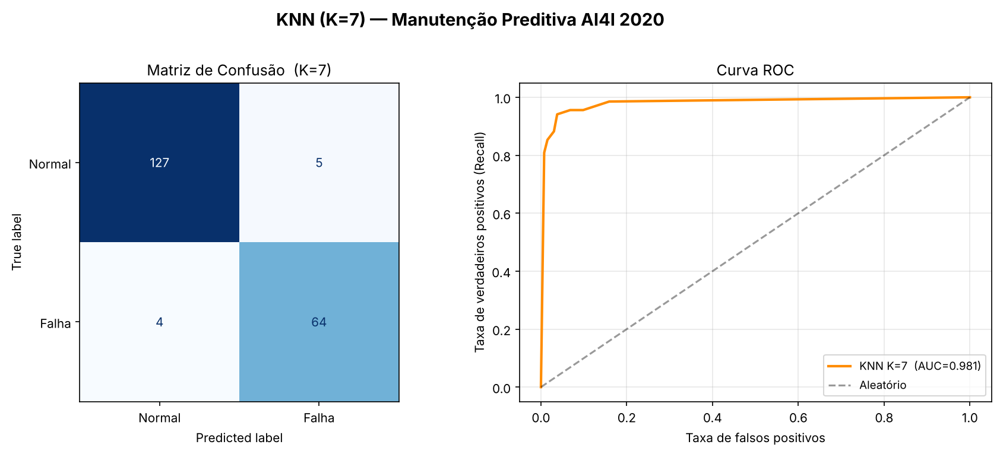
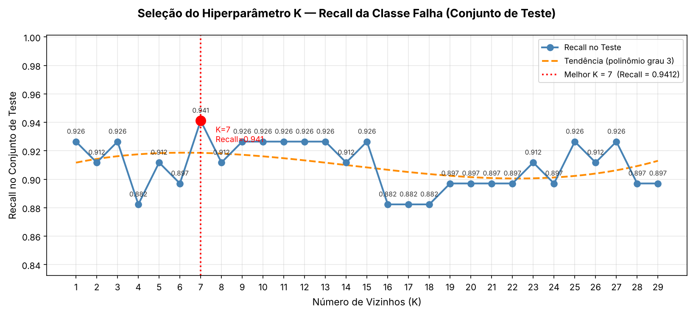

# 🏭 Manutenção preditiva com KNN

Modelo de classificação que **prevê falhas em máquinas industriais** a partir de leituras de sensores (temperatura, rotação, torque e desgaste da ferramenta). A ideia é trocar a manutenção "quebrou, conserta" por alertas antes da falha.

[](https://colab.research.google.com/github/renancarbonera04/portfolio/blob/main/02-manutencao-preditiva-knn/manutencao_preditiva_knn.ipynb)

Relatório completo: [`relatorio_knn.pdf`](relatorio_knn.pdf) · [Notebook original da disciplina no Colab](https://colab.research.google.com/drive/1f_6aKYDwK1XE7DgAK7pJ6UWvkxB8bWco)

## Resultado

No conjunto de teste (200 máquinas, 68 com falha), o modelo **detectou 64 das 68 falhas** e gerou só 5 alarmes falsos.

| Métrica | Valor | Em português claro |
|---|---:|---|
| Recall (falha) | **94,1%** | De cada 10 falhas reais, detecta mais de 9 |
| Precisão (falha) | **92,8%** | Poucos alarmes desnecessários |
| ROC-AUC | **0,981** | Separa muito bem máquinas normais de máquinas que vão falhar |



Priorizei o **Recall** porque, em manutenção, deixar passar uma falha (falso negativo) custa muito mais caro do que uma inspeção extra.

## Como funciona

1. **Dados:** amostra de 1.000 registros do dataset público [AI4I 2020 Predictive Maintenance](https://www.kaggle.com/datasets/stephanmatzka/predictive-maintenance-dataset-ai4i-2020) (66% normal, 34% falha), com 6 variáveis: tipo do produto, temperatura do ar, temperatura do processo, rotação, torque e desgaste.
2. **Pré-processamento:** remoção de identificadores, codificação do tipo (L/M/H) e padronização com `StandardScaler` ajustado só no treino.
3. **Divisão:** 80% treino / 20% teste, estratificada.
4. **Balanceamento:** SMOTE aplicado **apenas no treino**, para não contaminar a avaliação.
5. **Escolha do K:** KNN testado com K de 1 a 29; K = 7 teve o maior Recall.



O notebook termina com uma função `prever_falha()` que recebe as leituras de uma máquina e devolve a probabilidade de falha.

## Próximos passos

- **Escolher o K por validação cruzada só no treino.** Aqui o K foi escolhido olhando o próprio conjunto de teste, o que tende a deixar o resultado um pouco otimista. Num teste rápido com validação cruzada estratificada (5 folds, SMOTE dentro de cada fold), o K escolhido foi 3, com Recall de 92,6% e precisão de 94,0% no teste: desempenho parecido, avaliado de forma mais rigorosa.
- Comparar com modelos baseados em árvores (Random Forest, XGBoost), que costumam ir bem nesse dataset.

## Arquivos

| Arquivo | Conteúdo |
|---|---|
| [`manutencao_preditiva_knn.ipynb`](manutencao_preditiva_knn.ipynb) | Análise completa, do carregamento à função de predição |
| [`relatorio_knn.pdf`](relatorio_knn.pdf) | Relatório acadêmico (PUC-Campinas), versão atualizada |
| [`data/ai4i2020_amostra_1000.csv`](data/ai4i2020_amostra_1000.csv) | Amostra usada (separador `;`) |

## Como rodar

```bash
pip install -r ../requirements.txt
jupyter notebook manutencao_preditiva_knn.ipynb
```

No Colab, o notebook baixa a amostra direto deste repositório; é só rodar.

---

Trabalho em equipe com Marco Antonio Reis e Rafael Frade Trindade, sob orientação do Prof. Dr. Wemerson Delcio Parreira (PUC-Campinas). **Minha parte:** análise exploratória, pré-processamento (normalização e balanceamento com SMOTE) e implementação do modelo KNN.
