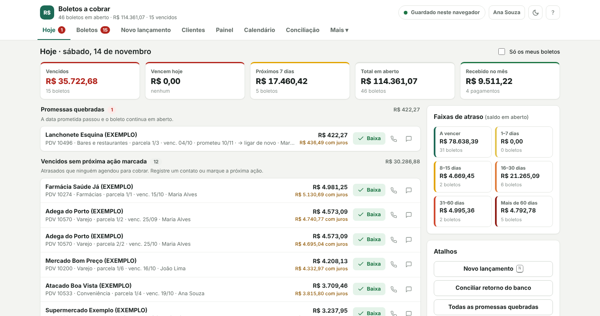
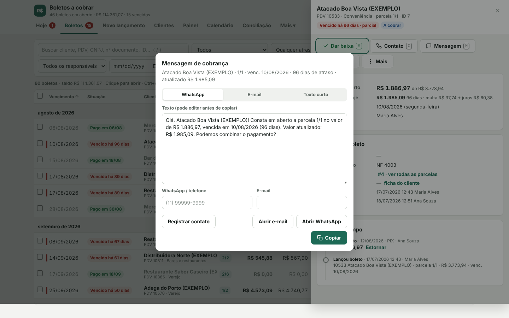
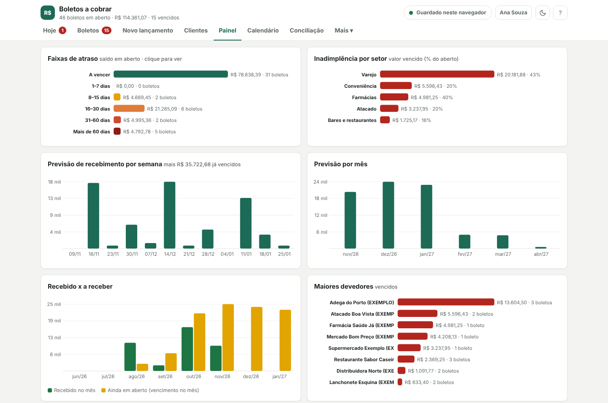

# 💸 Boletos a cobrar: sistema de cobrança em um único arquivo HTML

Sistema de cobrança para um time financeiro que **não podia instalar nada nem usar internet**. A solução é um único arquivo `.html` que abre com dois cliques no Edge ou no Chrome e usa uma **planilha do Excel numa pasta da rede como banco de dados**, compartilhada por várias pessoas ao mesmo tempo.

Criei para a rotina de cobrança do meu estágio em Finanças. Esta é a versão pública: **sem dados reais e sem marca da empresa**. Todos os clientes da planilha de exemplo são fictícios (terminam em "(EXEMPLO)").



## O que ele faz

- **Hoje:** lista o que precisa de ação no dia: promessas quebradas, vencimentos e boletos vencidos sem próxima ação.
- **Boletos:** busca, filtros, faixas de atraso (aging) e ações em lote.
- **Registrar contato:** canal, anotação, promessa de pagamento e próxima ação.
- **Mensagem de cobrança:** texto pronto para WhatsApp ou e-mail, com multa e juros já calculados.
- **Baixa** total ou parcial, com desconto, estorno e Ctrl+Z.
- **Conciliação bancária:** importa extrato OFX, retorno CNAB 240/400 ou CSV e sugere as baixas para conferir.
- **Lançamento rápido:** é só colar a linha digitável do boleto, e o sistema confere os dígitos e preenche valor e vencimento.
- **Painel:** gráficos de atraso, inadimplência por setor, previsão de recebimento e relatório do período.

| Mensagem de cobrança | Painel |
|---|---|
|  |  |

## Os desafios técnicos

| Restrição | Como resolvi |
|---|---|
| Sem internet, sem instalar nada, sem bibliotecas externas | Um HTML de ~420 KB com tudo dentro, inclusive um **leitor e gravador de `.xlsx` próprio** (ZIP + XML) |
| O navegador não grava em arquivos por conta própria | File System Access API, com 4 caminhos alternativos conforme o que o computador permite |
| Várias pessoas editando a mesma planilha, sem servidor | Cada ação vira uma **operação** que é reaplicada por cima da versão mais nova; conflitos no mesmo campo seguem a alteração mais recente |
| Planilha aberta no Excel, rede caindo, F5 no meio da gravação | Fila de gravação com novas tentativas automáticas; nada se perde e as alterações ficam guardadas no navegador até gravar |
| Erros humanos | Lixeira, histórico de tudo, desfazer/refazer e backups automáticos |

## Testes

```bash
node --test testes/unitarios.test.mjs   # 33 testes do núcleo (datas, valores, CNPJ, linha digitável, CNAB, mesclagem…)
bash testes/rodar_todos.sh              # + testes de ponta a ponta no navegador
```

Os testes de ponta a ponta simulam **4 computadores gravando ao mesmo tempo**, quedas no meio da gravação, planilha travada pelo Excel, desempenho com **10 mil boletos** e telas de 390 a 1440 px, em tema claro e escuro.

## Arquivos

| Arquivo | Conteúdo |
|---|---|
| [`Boletos-a-cobrar-v2.html`](Boletos-a-cobrar-v2.html) | O sistema inteiro (baixe e abra com dois cliques) |
| [`exemplo.xlsx`](exemplo.xlsx) | Planilha com dados fictícios para testar |
| [`GUIA.md`](GUIA.md) | Guia de uso para o time |
| [`NOTAS-TECNICAS.md`](NOTAS-TECNICAS.md) | Arquitetura, sincronização, formato da planilha |
| [`fonte/`](fonte/) | Código-fonte separado por módulos; `python3 fonte/montar.py` gera o HTML |
| [`testes/`](testes/) | Testes unitários e de ponta a ponta |

## Como experimentar

1. Baixe `Boletos-a-cobrar-v2.html` e `exemplo.xlsx` para a mesma pasta.
2. Abra o HTML no Chrome ou no Edge, digite um nome e escolha a pasta (ou a planilha).
3. Explore. Tudo fica gravado na planilha de exemplo.

Funciona junto com a [automação de WhatsApp em Excel/VBA](../04-automacao-whatsapp-excel/), que faz o primeiro contato com os clientes.
