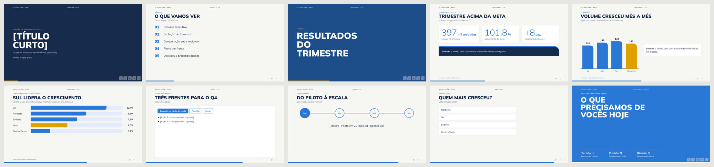

# 🤖 Treinamento de IA: apresentações em HTML interativo com Copilot

No estágio, comecei a montar minhas apresentações em HTML interativo usando IA. Elas chamaram atenção e viraram a oportunidade de **conduzir um treinamento de IA para a empresa**. Este é o kit que criei para o treinamento: o roteiro, a metodologia de prompts, os exercícios e os **agentes e a skill** que os participantes instalam para continuar usando depois.

> Versão pública: **sem a marca, os logos e o guia de identidade visual da empresa**. A identidade visual aqui é neutra, e a apresentação original do treinamento não está incluída porque usa a marca.



## O treinamento

| | |
|---|---|
| **Público** | Gestores e analistas que não programam |
| **Duração** | 2h30 (com versão compacta de 90 min) |
| **Resultado** | Cada participante gera, salva e apresenta a própria apresentação HTML feita com o Copilot |
| **Ferramentas** | Microsoft 365 Copilot (Chat, Agent Builder) e, na trilha avançada, VS Code + GitHub Copilot |

O conteúdo vai de **como a IA generativa funciona** (previsão da próxima palavra, temperatura, janela de contexto) até **skills e agentes**, passando por um método de prompt próprio.

### Método CRIAR

Cinco ingredientes de um prompt que gera bons slides de primeira:

| Letra | Ingrediente | Exemplo |
|---|---|---|
| **C** | Contexto | Quem fala, para quem, em que situação |
| **R** | Resultado | O entregável exato: um único arquivo HTML, N slides 16:9 |
| **I** | Identidade | Fontes, paleta e tom da marca |
| **A** | Ações | O que o público faz: navegar, clicar nas abas, responder o quiz |
| **R** | Regras | Limites e checagens: **não invente números**, use `[XX]` se faltar dado |

O R final é o mais esquecido, e é ele que evita número inventado e código quebrado.

## Agentes e skill

O kit ensina a parar de reescrever o mesmo prompt: **a skill é o procedimento padrão** que a IA segue sempre que o assunto aparece, e **cada agente é um especialista** com função e regras próprias.

**VS Code + GitHub Copilot:** um time de 3 agentes com *handoffs*:

```
roteirista  ──▶  designer-html  ──▶  revisor
(história e     (gera o HTML a     (audita dados, marca,
 dados, sem      partir da skill)   acessibilidade e bugs)
 código)               ▲                 │
                       └── correções ────┘
```

**Microsoft 365 Copilot (sem código):** dois agentes no Agent Builder, o **Arquiteto de Apresentações** (cria) e o **Revisor** (audita e devolve o arquivo corrigido).

Todos seguem as mesmas proteções:
- **Nunca inventar números:** só dados do usuário; lacunas viram `[XX]`.
- **Um único arquivo, sem dependências externas:** abre com dois cliques e funciona offline.
- **Checklist de qualidade** antes de entregar, com acessibilidade (contraste, tamanho de fonte, `prefers-reduced-motion`).
- **Roteiro antes do código:** a IA propõe a história em tabela e espera aprovação.

## Estrutura

| Pasta | O que tem |
|---|---|
| [`roteiro/`](roteiro/) | Roteiro do facilitador (minuto a minuto, FAQ), [biblioteca de prompts](roteiro/biblioteca-de-prompts.md) e [exercícios](roteiro/exercicios.md) em 3 níveis com rubrica |
| [`vscode-github-copilot/.github/`](vscode-github-copilot/.github/) | [Skill](vscode-github-copilot/.github/skills/apresentacao-html/SKILL.md), 3 agentes, 3 *prompt files* e instruções do repositório |
| [`.../skills/apresentacao-html/`](vscode-github-copilot/.github/skills/apresentacao-html/) | Template HTML (navegação, notas do apresentador, modo tela cheia), componentes interativos e guia de marca modelo |
| [`copilot-m365/`](copilot-m365/) | Instruções dos agentes do Agent Builder e o passo a passo de instalação |

## Como usar

- **VS Code:** copie a pasta `.github` para o seu repositório, escolha o agente **roteirista** no chat do Copilot e cole o briefing.
- **Microsoft 365 Copilot:** siga [`copilot-m365/COMO-INSTALAR.md`](copilot-m365/COMO-INSTALAR.md).
- **Ver o template:** baixe a pasta da skill e abra [`assets/template-apresentacao.html`](vscode-github-copilot/.github/skills/apresentacao-html/assets/template-apresentacao.html) no navegador (← → navegam, `F` tela cheia, `N` notas, `O` visão geral).
- **Usar a sua marca:** troque os tokens no topo do template e preencha `references/guia-de-marca.md`.
