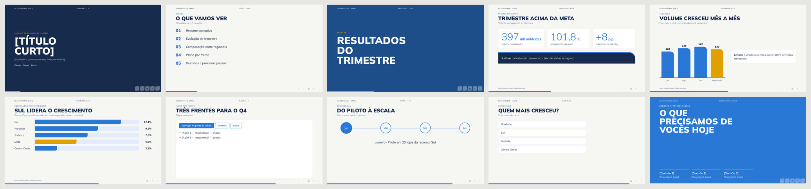
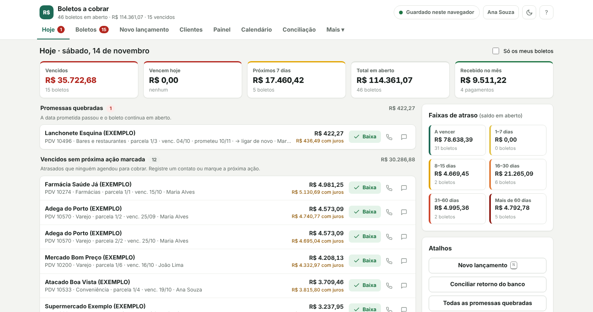
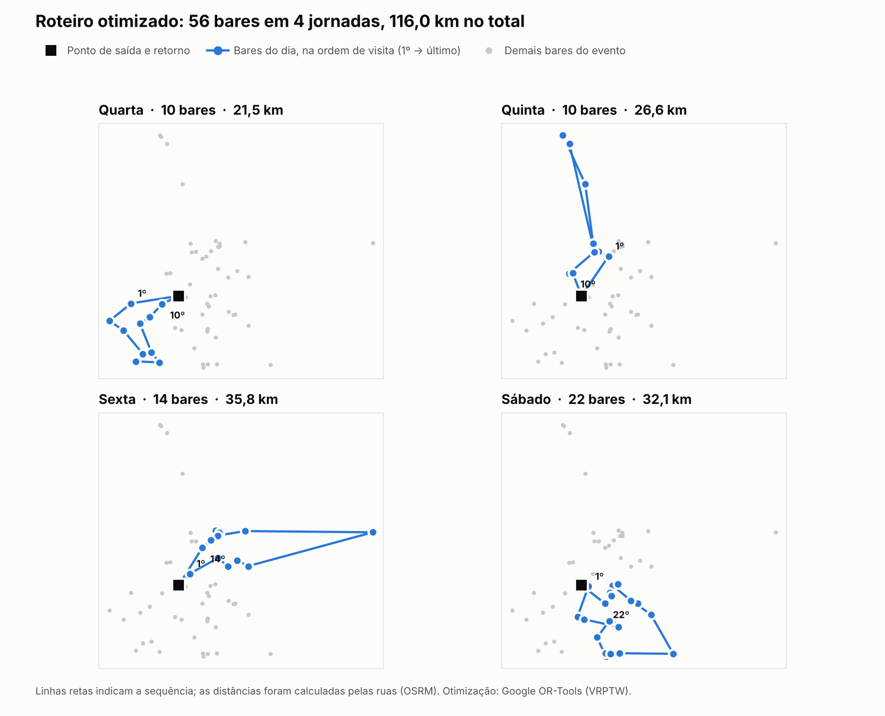

# Projetos · Renan Carbonera

Estudante de **Engenharia de Produção na PUC-Campinas** (bolsista integral), com formação técnica em Desenvolvimento de Sistemas. Uso **IA generativa, automação e otimização** para transformar problemas de negócio em ferramentas que funcionam.

Os projetos da faculdade têm código, dados e resultados para conferir. Os do estágio estão em **versão pública, sem dados reais e sem a marca da empresa**.

## IA e automação

### [🤖 Treinamento de IA: apresentações em HTML com Copilot](05-treinamento-ia-apresentacoes-html/)

<a href="05-treinamento-ia-apresentacoes-html/"></a>

Minhas apresentações feitas com IA me levaram a **conduzir um treinamento de IA para a empresa**. O kit tem o método de prompt **CRIAR**, a biblioteca de prompts, exercícios em 3 níveis, uma **skill** e um **time de agentes** (roteirista → designer → revisor) para Microsoft 365 Copilot e GitHub Copilot.

`Prompt engineering` `Agentes` `Skills` `GitHub Copilot` `Microsoft 365 Copilot` `HTML/CSS/JS`

### [💸 Sistema de cobrança em um único arquivo HTML](03-sistema-de-cobranca/)

<a href="03-sistema-de-cobranca/"></a>

Sistema offline e sem instalação para o time financeiro: usa uma **planilha do Excel na rede como banco de dados** compartilhado, gera mensagens de cobrança com juros e multa, faz conciliação bancária (OFX, CNAB 240/400) e tem painel de inadimplência. **33 testes unitários** e testes de ponta a ponta com 4 computadores gravando ao mesmo tempo.

`JavaScript` `HTML/CSS` `File System Access API` `Excel (.xlsx)` `Python (testes)` `Playwright`

### [📲 Excel + WhatsApp: primeiro contato automático com clientes](04-automacao-whatsapp-excel/)

Macro VBA que envia mensagens personalizadas pelo WhatsApp Web a partir de uma base no Excel, **confere cada envio na tela** e registra o resultado na planilha, com várias proteções contra erro.

`VBA` `Excel` `APIs do Windows` `Automação`

## Dados e otimização

### [🍺 Rota ótima pelos 56 bares do Comida di Buteco Campinas](01-roteirizacao-comida-di-buteco/)

<a href="01-roteirizacao-comida-di-buteco/"></a>

Problema de roteirização com janelas de tempo (VRPTW): **web scraping** dos horários, distâncias reais pelas ruas com **OSRM** e otimização com **Google OR-Tools**. **116 km contra 227 km na ordem alfabética (−49%)**. Artigo apresentado no X SAEPRO (EEL-USP).

`Python` `OR-Tools` `OSRM` `Playwright` `BeautifulSoup` `Pandas`

### [🏭 Manutenção preditiva com KNN](02-manutencao-preditiva-knn/)

Modelo que prevê falhas de máquinas industriais a partir de sensores (dataset AI4I 2020): **detecta 64 de 68 falhas** no teste, com Recall de 94,1% e ROC-AUC de 0,981.

`Python` `scikit-learn` `imbalanced-learn` `Pandas` `Matplotlib`

## Como rodar

Cada pasta tem um README próprio. Os notebooks têm o botão **Abrir no Colab**. Para rodar localmente:

```bash
git clone https://github.com/renancarbonera04/portfolio.git
cd portfolio
pip install -r requirements.txt
jupyter notebook
```

## Contato

[LinkedIn: Renan Carbonera](https://www.linkedin.com/in/renan-carbonera/)
